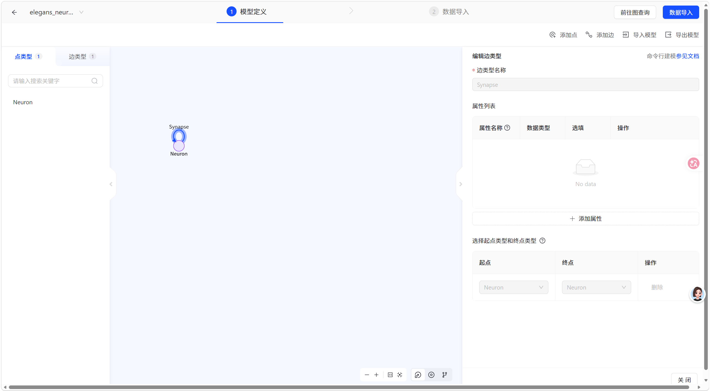
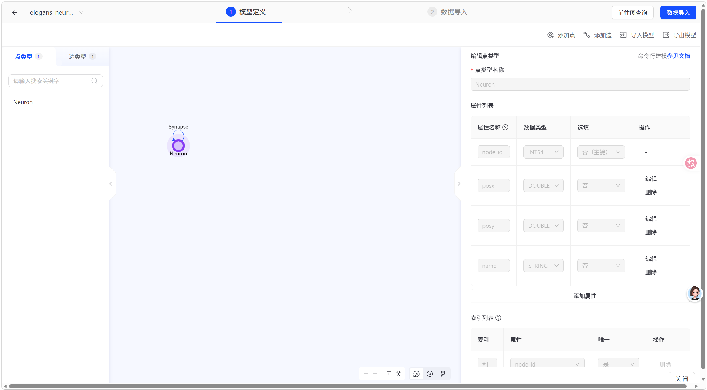

# TuGraph_homework1
TuGraph图数据库实验作业

## 1. TuGraph平台部署启动
### 部署步骤
本次实验采用阿里云图数据库TuGraph，在阿里云控制台创建TuGraph实例，通过Web控制台访问图数据库服务：
1. 在阿里云平台创建TuGraph实例，选择合适规格，等待实例创建完成；
2. 开启实例公网访问，配置白名单，获取Web控制台访问地址；
3. 使用账号密码登录TuGraph Web可视化控制台，平台启动成功，进入图建模页面。

系统登录截图：

## 2. 模型建立、数据导入、增删改查
本次实验数据集为 SNAP C.elegans-frontal，节点代表线虫的神经元，有向边代表神经元之间的突触信号传递。
### 2.1 图模型建立
节点类型：`Neuron`（神经元），属性：`id`（神经元编号）
关系类型：`Synapse`（突触连接），有向关系，代表神经元A向神经元B发送信号

### 2.2 数据导入
将原始C-elegans-frontal.txt预处理为node.csv、edge.csv，在TuGraph控制台使用批量导入功能，上传两份csv文件，完成神经元网络数据导入。

数据导入成功截图：

### 2.3 增删改查（Cypher语句+结果截图）
#### 查询（Read）：查询编号为10的神经元，以及它发出突触连接的所有下游神经元

#### 新增：创建测试神经元并添加突触连接

#### 修改 node_id=999 这个测试神经元的 name 属性，改成 "TEST_UPDATED"

#### 删除：移除测试神经元和新增突触

#### 聚合统计查询：统计神经元出度，筛选前 10 高输出神经元
