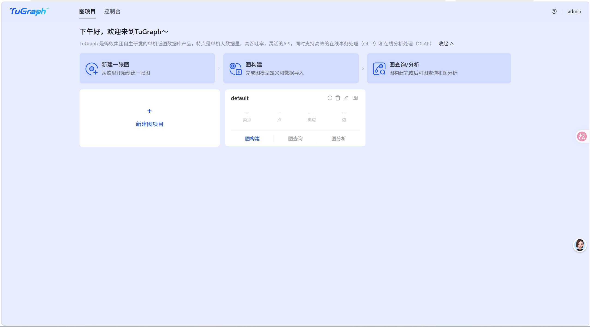

# TuGraph_homework1
TuGraph图数据库实验作业

## 1. TuGraph平台部署启动
### 部署步骤
本次实验采用阿里云图数据库TuGraph，在阿里云控制台创建TuGraph实例，通过Web控制台访问图数据库服务：
1. 在阿里云平台创建TuGraph实例，选择合适规格，等待实例创建完成；
2. 开启实例公网访问，配置白名单，获取Web控制台访问地址；
3. 使用账号密码登录TuGraph Web可视化控制台，平台启动成功，进入图建模页面。

系统登录截图：


## 2. 模型建立、数据导入、增删改查
本次实验使用TuGraph系统内置生成的电影数据集，图模型结构如下：
节点类型：
- `person`：人员（演员、导演、编剧、制片人）
- `movie`：电影
- `user`：用户
- `keyword`：关键词
- `genre`：电影类型

关系类型：
- `acted_in`：person 参演 movie
- `directed`：person 导演 movie
- `write`：person 编剧 movie
- `produce`：person 制片 movie
- `rate`：user 给 movie 评分
- `is_friend`：user 和 user 互为好友
- `has_keyword`：movie 包含关键词 keyword
- `has_genre`：movie 属于类型 genre

### 2.1 图模型建立
在TuGraph可视化建模页面，依次创建上述5类节点、8类关系，完成Schema模型构建，和图结构保持一致。

模型创建截图：


### 2.2 数据导入
使用TuGraph控制台自带的系统生成样例数据功能，一键生成配套电影数据集，数据自动加载进当前图实例，无需手动导入csv文件。

数据加载完成截图：


### 2.3 增删改查（Cypher语句+结果截图）
#### （1）查询（Read）：查询编号1的电影，以及参演该电影的所有演员
```cypher
MATCH (p:person)-[:acted_in]->(m:movie)
WHERE id(m) = 1
RETURN p, m;
